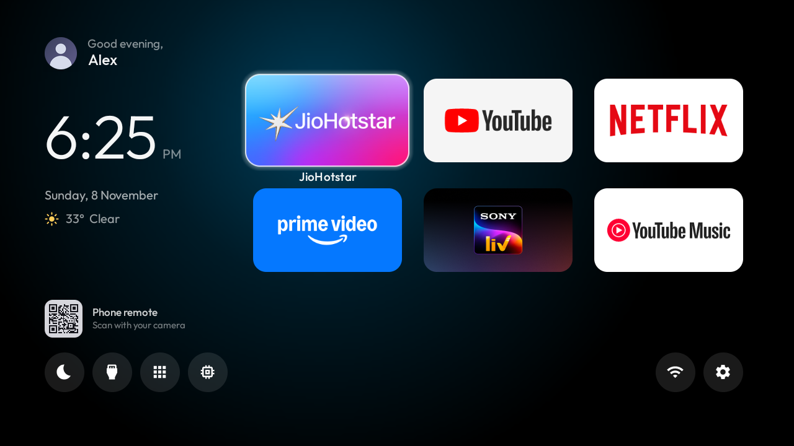
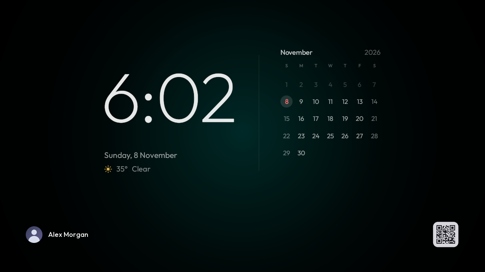
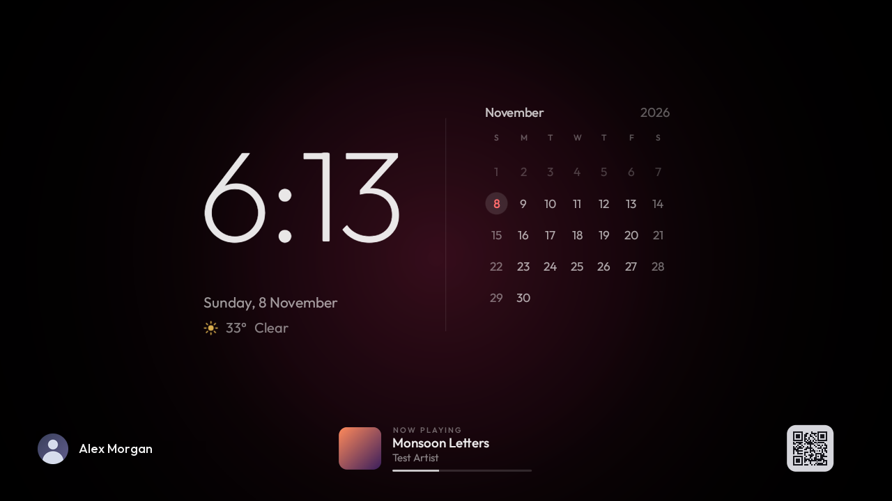
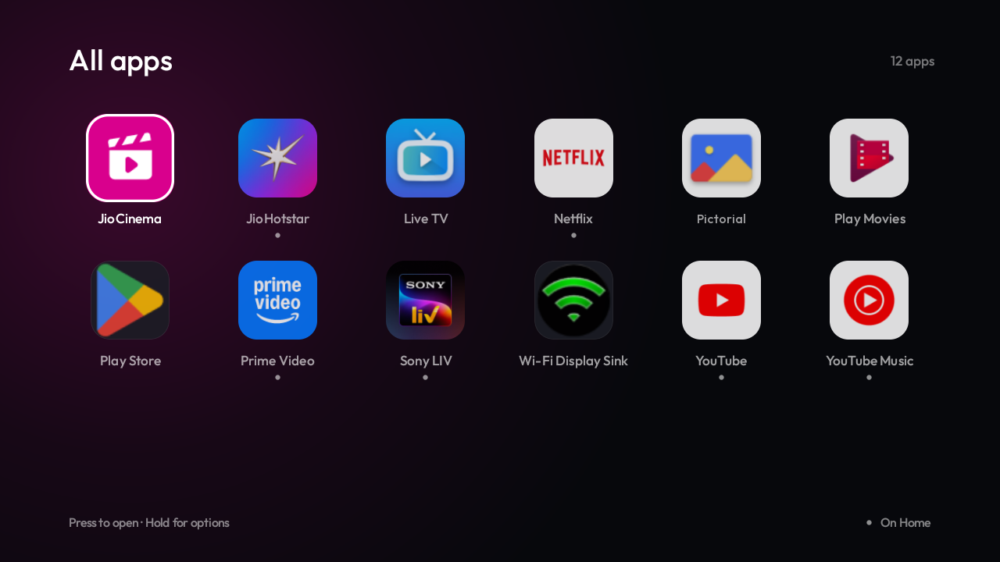
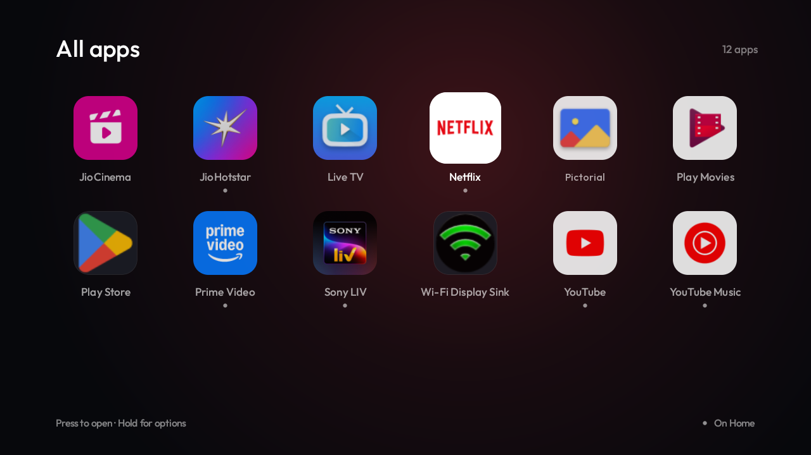
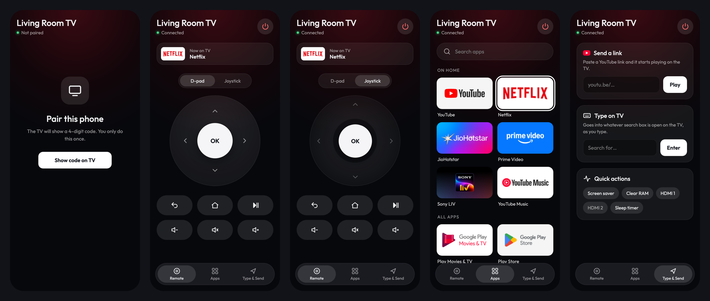
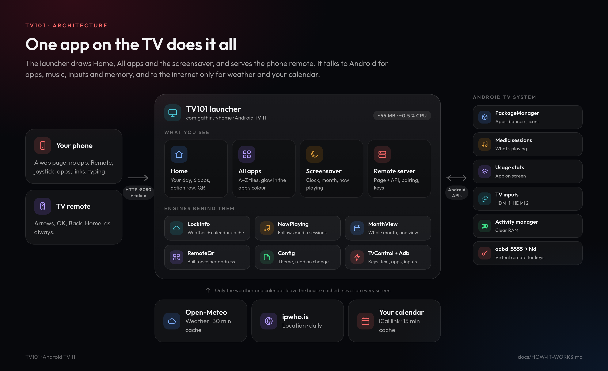
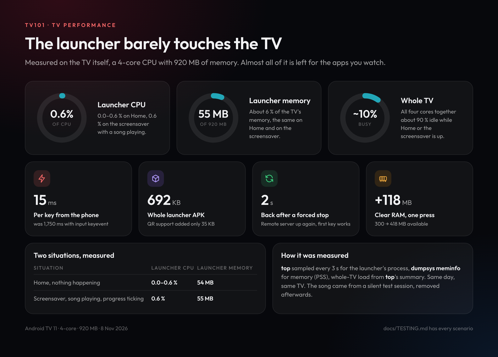

# TV101

A custom home screen, screensaver and phone remote for **Android TV** (built and tested on an Android TV 11 set).
It replaces the stock Google TV launcher with something calm, fast and personal, and turns any phone on the home
Wi-Fi into a remote.

**New here? Start with the [How to use guide](docs/GUIDE.md)**: everyday use, setting it up, and how to let
Claude Code install, change and fix it for you.
**How it works, in pictures:** [docs/HOW-IT-WORKS.md](docs/HOW-IT-WORKS.md): architecture, the phone remote,
Clear RAM, why it's light, TV performance and the smart features.



| Screensaver | Now playing on the screensaver |
|---|---|
|  |  |

| All apps | Glow follows the selected app |
|---|---|
|  |  |



## Features

**Home: a dashboard**
- Your day on the left: photo and greeting, a thin clock, date, weather, the next calendar event.
- Six apps as large cards on the right; the selected one lifts, shows its name, and the background glows in its colour.
- One action row: Screen saver, Inputs, All apps, Clear RAM, Wi-Fi, Settings. A white disc slides between them.
- A QR code that opens the phone remote.

**All apps: a refined Launchpad**
- Every app A to Z on identical rounded tiles, six to a row; a dot marks the ones on Home.
- The background glows in the selected app's colour, worked out once from its icon.

**Screensaver: clock and month**
- A thin clock with the date and weather beside the whole month; today is the only colour.
- Now playing: the song, artist, album art and progress of whatever music is playing, fading away 30 s after it stops.
- Your name and the phone remote's QR along the bottom. The whole screen shifts a few pixels each minute against burn-in.

**Phone remote: `http://<TV>:8080`**
- D-pad or joystick (drag further to move faster, tap for OK), Back, Home, play/pause, volume, power.
- Open any app, send a YouTube link to play, type into the TV's search box live, switch HDMI, screensaver,
  Clear RAM, sleep timer.
- Pair once with a 4-digit code the TV shows; works from the home screen like an app.

See [docs/FEATURES.md](docs/FEATURES.md) for every detail, and [docs/TESTING.md](docs/TESTING.md) for what was tested on the TV.

## How it fits together



## Performance

Measured on the TV (4-core MediaTek, 920 MB RAM): the launcher sits at **0 to 0.6 % CPU and about 55 MB** on Home and
on the screensaver with music playing. How: one view draws the whole month and redraws only when the date changes;
Now playing reacts to media-session events and ticks once a second only while music plays; weather and calendar are
cached (30 and 15 minutes); the QR is built once per address; the phone remote's keys go through a virtual remote
control that is always ready, about 15 ms per press instead of ~1.7 s for `input keyevent`.
More in [docs/ARCHITECTURE.md](docs/ARCHITECTURE.md).



## Quick start

```sh
# Needs adb, JDK 17+ and the Android SDK (ANDROID_HOME). USB debugging on in the TV's Developer options.
TV_HOST=192.168.1.50 scripts/install.sh
```

Then accept "Allow USB debugging?" on the TV with **Always allow** ticked, open `http://<TV>:8080` on your phone (or scan
the QR on Home) and pair. Full steps, settings and how to undo everything: [docs/SETUP.md](docs/SETUP.md).

## Repository

```
TV101/
├── launcher/            Android launcher (Home, All apps, screensaver, phone remote server)
│   └── app/src/main/
│       ├── java/com/gathin/tvhome/   MainActivity, AppLibraryDialog, ClockScene, NowPlaying, MonthView,
│       │                             RemoteServer, TvControl, Adb, LockInfo, Ics, RemoteQr, ...
│       ├── assets/remote/            the phone remote's page (index.html)
│       └── res/                      layouts, drawables, strings, the profile photo
├── theme/default/       the neutral theme; copy it to theme/my-tv for your name and photo (never committed)
├── phone-remote/        README (pairing, API, security) and dev-server.py to design the page without a TV
├── scripts/             install.sh, push-theme.sh, tv-test.sh
├── docs/                guide, how it works (diagrams), features, setup, architecture, testing, debloat,
│                        screenshots, design mockups; visuals/src has the diagrams' sources
└── CLAUDE.md            project notes Claude Code reads automatically
```

## Credits

The launcher is built on [cleanyourtv](https://github.com/Gathin23/cleanyourtv) by Gathin (MIT); the Outfit font is
under the SIL Open Font License. See [CREDITS.md](CREDITS.md).

> Nothing personal is in this repository. Your name, photo and TV-specific apps go in your own `theme/my-tv/`
> folder, which git ignores; see [docs/SETUP.md](docs/SETUP.md#4-personal-settings).
