# Features

Every screen, what it shows, and how it behaves with the remote.

## Home: dashboard

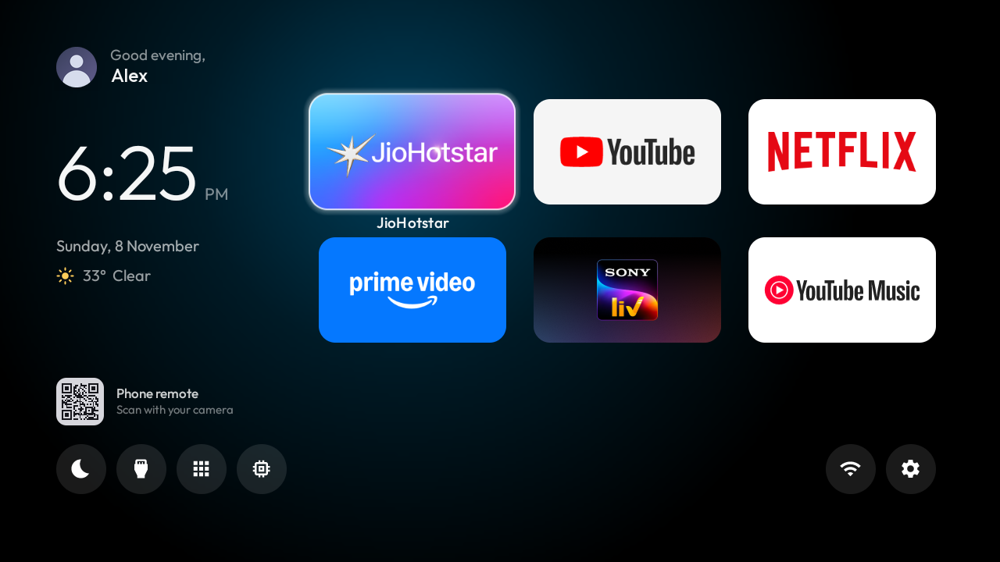

| Area | What it shows |
|---|---|
| Top left | Profile photo, "Good evening," and the name on its own line. The greeting follows the time of day. |
| Clock | Thin `h:mm` with AM/PM, the full date under it. |
| Weather | Icon, temperature and sky ("33° Clear"), from Open-Meteo. Hidden until the first reading arrives. |
| Up next | The next calendar event (title and time) under a hairline, once a private iCal link is set. |
| QR | Opens the phone remote; rebuilt only if the TV's address changes. Never takes focus. |
| Apps | The six Home apps as 16:9 cards in a 3 × 2 grid, centred on the right. |
| Action row | Screen saver, Inputs, All apps, Clear RAM on the left; Wi-Fi and Settings on the right, ending under the last card. |

**Focus.** The selected card lifts (scale 1.10) with a white outline and shows its name; the background glow slides
under it in that app's colour. In the action row one white disc springs from button to button and the button's
name fades in under it.

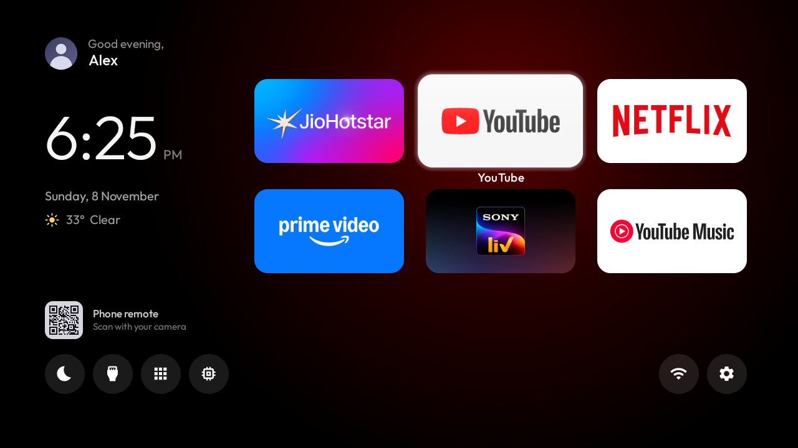
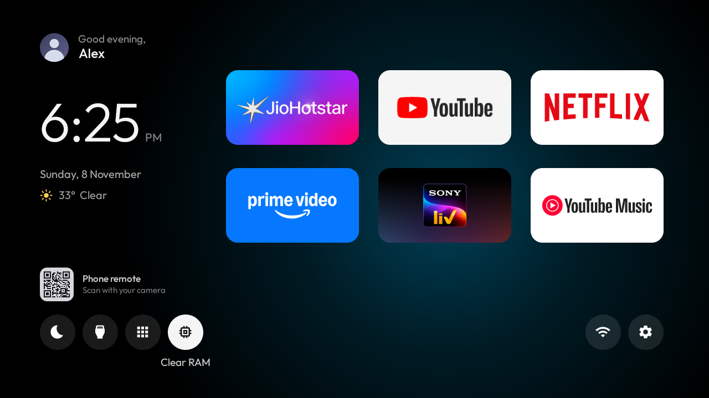

**Remote.** Down from the second row goes to the action row; Left/Right step one button at a time and stop at the
ends; Up returns to the app you came from.

**Clear RAM** stops other apps' background processes and says what came back ("Freed 118 MB · 418 MB available").
It is also in the Settings button's long-press menu.

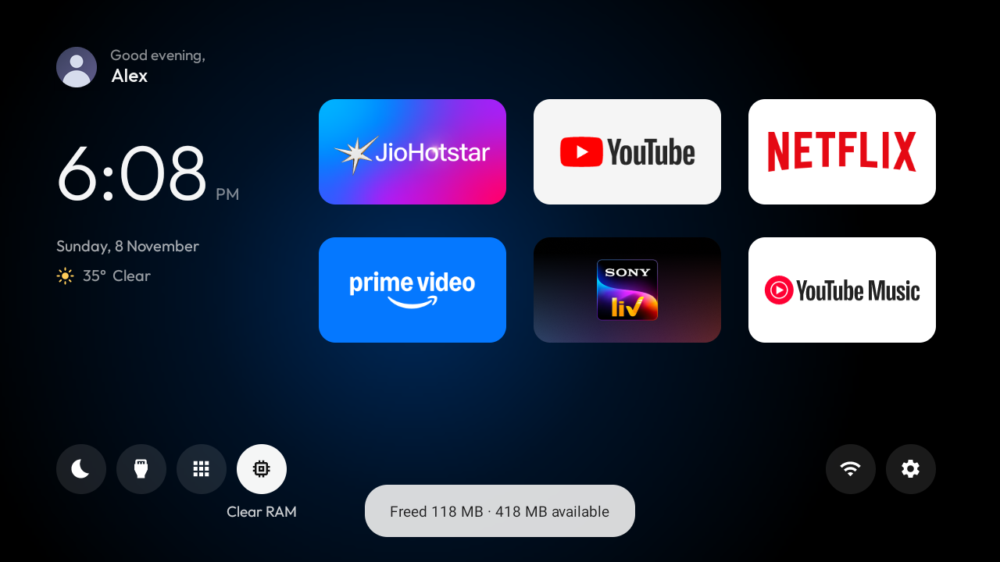

## All apps: refined Launchpad

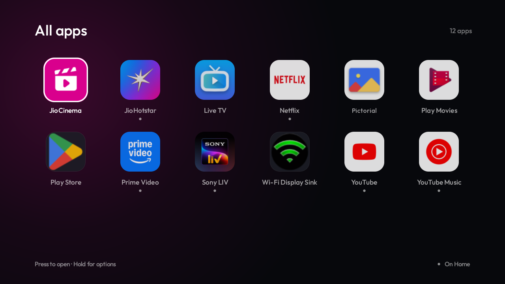

- Every launchable app, A to Z, six to a row, on identical 76 dp rounded tiles: round or see-through icons sit on the
  same dark tile as the rest.
- A small dot under the name marks apps that are on Home (explained in the footer).
- The selected tile lifts 12 % with a shadow and a white ring; the others dim slightly; names stay on one line.
- The panel is solid, with a radial glow that moves under the selected app and fades to its colour, which is taken
  once from the app's icon (the average of its saturated pixels at 16 × 16).
- OK opens the app; holding OK offers Open, Add to Home / Remove from Home, App info. Back closes.

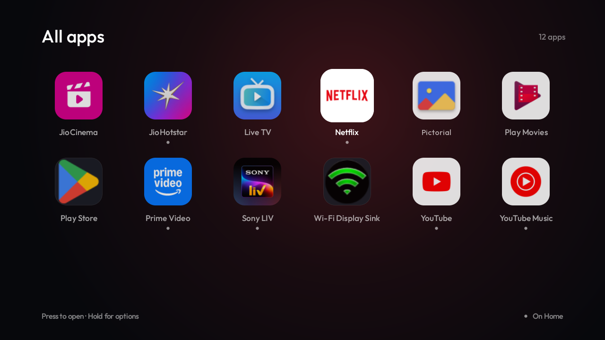

## Screensaver

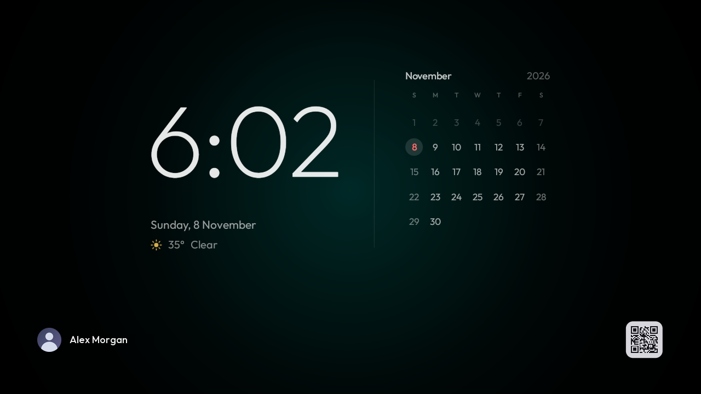

- A thin clock, the date and the weather on the left; a hairline; the whole month on the right. Weeks start on
  Sunday, past days are faint, weekends dimmer, today a coral number on a soft disc.
- Along the bottom: the profile photo and full name, the song that is playing, and the phone remote's QR.
- The glow behind it shifts colour slowly; the content moves a few pixels every minute so nothing burns in.
- Starts after 2 minutes idle, from the moon button on Home, or from the phone.

### Now playing

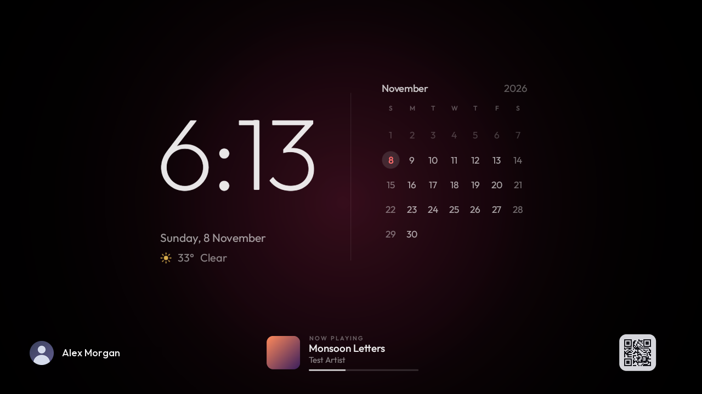
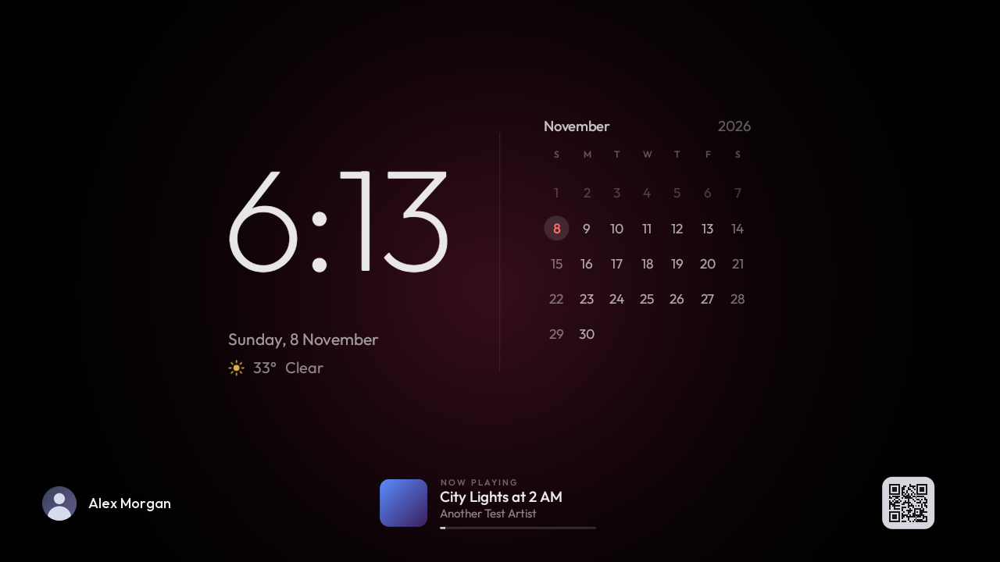

- Album art, title, artist and a progress bar for whatever app publishes a media session with song details.
- Appears when music plays, follows song changes, stays while paused and fades away 30 s after it stops.
- **YouTube / YouTube Music on Android TV will not show:** they stop playing as soon as anything covers them and
  publish no song details. Apps that play in the background do show (Spotify, or a phone playing to the TV over
  Bluetooth).

## Phone remote

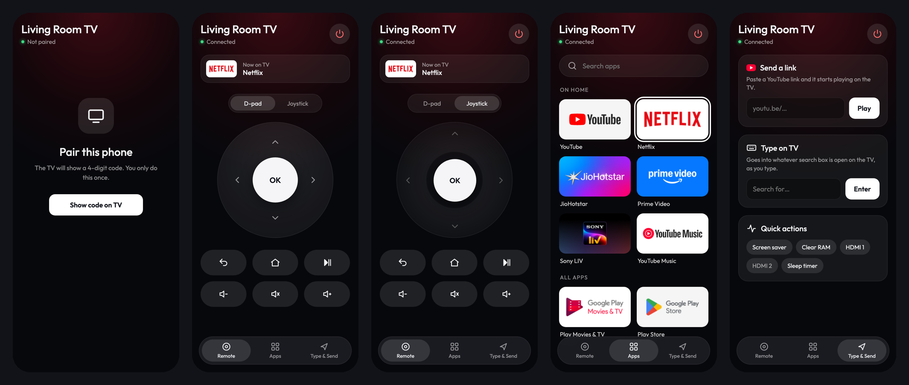

Open `http://<TV address>:8080` on a phone on the same Wi-Fi, or scan the QR on Home or the screensaver.

- **Pairing:** "Show code on TV" puts a 4-digit code in the TV's top-right corner; enter it once. Five wrong tries
  throw the code away. Up to ten phones stay paired.
  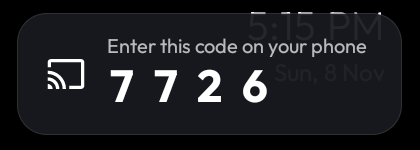
- **Remote tab:** what is on the TV now; D-pad or joystick; Back, Home, play/pause, volume down/mute/up, power.
  Holding an arrow or volume repeats it. The joystick moves faster the further you drag; a tap is OK.
- **Apps tab:** your Home apps and every other app with their TV banners, a search box; tap to open on the TV.
- **Type & Send:** paste a YouTube link and it plays; type and it appears in the TV's search box as you type (Enter
  submits); quick actions for the screensaver, Clear RAM, each HDMI input, and a sleep timer (30, 60, 90 min).

Details, the API and the security model: [../phone-remote/README.md](../phone-remote/README.md).

## Weather and calendar

- Weather: Open-Meteo, no account. Location: `weather_city` in the theme if set, else where the internet connection
  says the TV is (some internet providers report a nearby big city instead). Refreshed every 30 minutes; hidden if older than 3 hours.
- Calendar: set `calendar_ics_url` in the theme to Google Calendar's *secret address in iCal format*. Read every
  15 minutes; repeating events, exceptions, moved and cancelled events and time zones are handled (see `Ics.java`).
