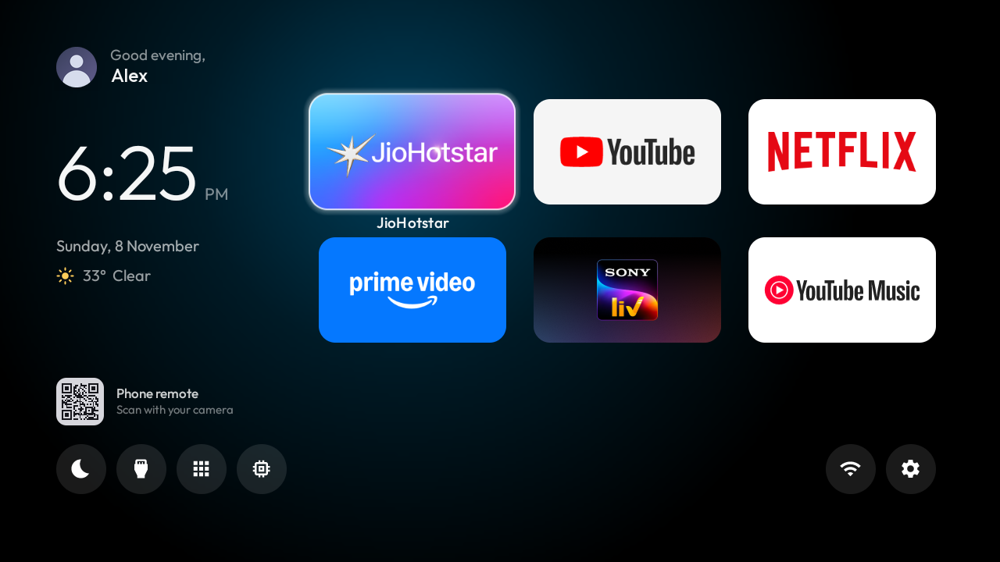
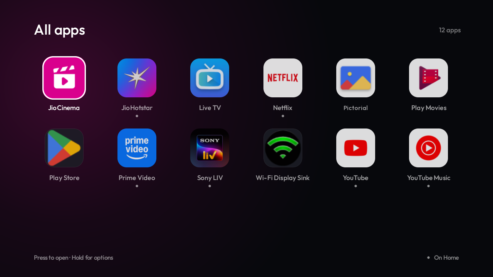
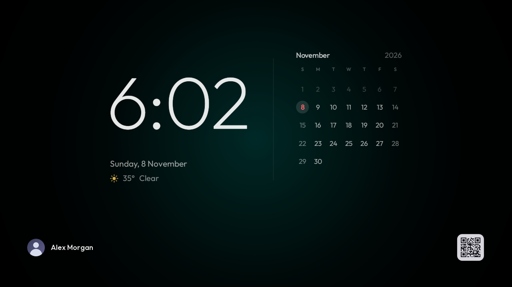
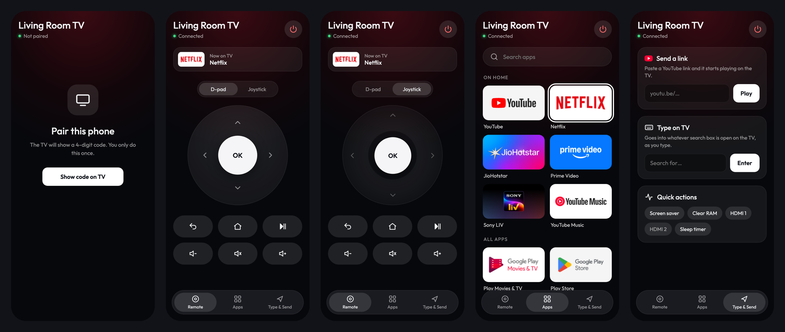

# How to use TV101

A plain-language guide in three parts:

1. **[Everyday use](#1-everyday-use)**: the TV remote, Home, All apps, the screensaver and the phone remote. No computer needed.
2. **[Set it up yourself](#2-set-it-up-yourself)**: install everything on a TV with a few commands.
3. **[Let Claude do it](#3-let-claude-do-it)**: ask Claude Code in plain English to install, change, fix or test anything.

---

## 1. Everyday use

### Home



| You want to… | Do this |
|---|---|
| Open an app | Move to its card with the arrows, press **OK** |
| See an app's name | Just move onto it: the name appears under the card |
| Start the screensaver | Press **Down** to the round buttons, the first one (moon), **OK** |
| Switch to HDMI | Round buttons → second one (Inputs) → choose the port |
| See every app | Round buttons → third one (grid) → **All apps** |
| Free up memory | Round buttons → fourth one (chip) → **Clear RAM**. A message says how much was freed |
| Wi-Fi or Settings | The two round buttons on the right |
| Go back to the apps | Press **Up** |

Weather and the date update by themselves. "Up next" appears under the weather once a calendar is connected
(see [Setup → Personal settings](SETUP.md#4-personal-settings)).

### All apps



- Every app, A to Z. A small **dot** under a name means it's also on Home.
- **OK** opens the app. **Hold OK** for options: *Add to Home*, *Remove from Home*, *App info*.
- **Back** closes the screen.

### Screensaver



- Starts by itself after 2 minutes without pressing anything, or from the moon button.
- Shows the time, date, weather and this month. Today is the coloured number.
- If music is playing in an app that supports it (Spotify, or your phone over Bluetooth), the song appears at the
  bottom. YouTube Music can't show here: it stops playing when anything covers it.
- **Press any button** to return to where you were.

### Phone remote



**First time (once per phone):**

1. Make sure the phone is on the **same Wi-Fi** as the TV.
2. Scan the **QR code** on the TV's Home screen (bottom of the left side) with the phone camera. It opens
   `http://<TV address>:8080`.
3. Tap **Show code on TV**. A 4-digit code appears in the TV's top-right corner.
4. Type the code on the phone. Done: the phone stays paired.
5. Optional, so it opens like an app:
   - **iPhone:** in Safari, tap Share → *Add to Home Screen*.
   - **Android:** in Chrome, tap ⋮ → *Add to Home screen*.

**Using it:**

| Tab | What you can do |
|---|---|
| **Remote** | Arrows and OK (or switch to **Joystick**: drag the knob, further = faster, tap = OK), Back, Home, play/pause, volume, mute. The red button turns the TV off. |
| **Apps** | Tap any app to open it on the TV. Search box at the top. |
| **Type & Send** | Paste a YouTube link and press **Play**. Type into the TV's search box live, **Enter** to search. Quick buttons: screensaver, Clear RAM, HDMI 1 / 2, sleep timer (tap again for 60, 90, off). |

**If something doesn't work:**

| You see | Why | Fix |
|---|---|---|
| "TV not reachable" | Phone and TV aren't on the same Wi-Fi, or the TV is off | Check the Wi-Fi; turn the TV on |
| A yellow note: "choose Always allow" | The TV is asking whether the launcher may control it | On the TV, tick **Always allow**, then **Allow** |
| A yellow note: "keys need network debugging" | USB debugging got switched off | TV Settings → Developer options → **USB debugging** on. Apps, links and HDMI still work meanwhile |
| The QR or saved link stopped working | The router gave the TV a new address | Scan the new QR on Home. To stop it happening, reserve the TV's address in the router |
| Asked to pair again | The phone's browser data was cleared | Pair again (step 3) |

---

## 2. Set it up yourself

You need a Mac or PC with `adb`, JDK 17+ and the Android SDK. [SETUP.md](SETUP.md) has the exact install commands.

1. **On the TV:** Settings → Device Preferences → About → press **Build** 7 times. Then Developer options →
   **USB debugging** on. Note the TV's address from Settings → Network (e.g. `192.168.1.50`).
2. **On the computer**, in the TV101 folder:
   ```sh
   TV_HOST=192.168.1.50 scripts/install.sh
   ```
3. **On the TV:** when "Allow USB debugging?" appears, tick **Always allow**, press **Allow**. It may ask a
   second time for the launcher's own key; allow that too.
4. Pair your phone (see [Phone remote](#phone-remote)).

**Make it yours** (name, photo, weather city, calendar, which apps are on Home): copy the default theme once with
`cp -R theme/default theme/my-tv`. That folder never goes to GitHub. Edit `theme/my-tv/config.json`, then:

```sh
TV_HOST=192.168.1.50 scripts/push-theme.sh theme/my-tv
```

**Your photo:** save a square picture as `theme/my-tv/avatar.jpg` and push the theme again. No rebuild needed.

---

## 3. Let Claude do it

[Claude Code](https://docs.claude.com/en/docs/claude-code/overview) is an AI assistant that works in your terminal
or in VS Code. It can read this project, run the commands, look at the TV's screen and fix things, while you
describe what you want in plain English. This whole project was built that way.

### One-time setup

1. **Install Claude Code.** Follow the [official instructions](https://docs.claude.com/en/docs/claude-code/setup). On
   a Mac it's usually:
   ```sh
   curl -fsSL https://claude.ai/install.sh | bash
   ```
   If you use VS Code, you can install the **Claude Code** extension instead.
2. **Open the project:**
   ```sh
   cd ~/Documents/Projects/TV101
   claude
   ```
   In VS Code: *File → Open Folder → TV101*, then open the Claude Code panel.
3. Claude reads [`CLAUDE.md`](../CLAUDE.md) in this folder by itself. It holds the TV's details, the commands and
   the safety rules, so you don't need to explain the project.

### What to ask: copy and paste, change the parts in < >

**Install and connect**
- *"Set up TV101 on my TV at <192.168.1.50>. USB debugging is already on."*
- *"Check whether the TV is connected and tell me what's on screen."*
- *"The phone remote says keys are off. Find out why and fix it."*

**Personalise**
- *"Change the weather city to <London>."*
- *"Add my Google Calendar. Here is the secret iCal link: <link>."*
- *"Put <Spotify> on Home instead of <Sony LIV>."*
- *"Change the greeting name to <Alex>."*
- *"Use this photo for my profile: <path to photo>."*

**Design changes** (Claude will show mockups first if you ask)
- *"Make the clock on Home bigger. Show me a mockup before changing anything."*
- *"Give me 3 ideas for a new screensaver and wait for me to pick one."*
- *"The white focus ring is hard to see on white icons in All apps. Fix that."*

**Fix and test**
- *"Something looks wrong on Home. Take a screenshot and tell me what you see."*
- *"Test the phone remote: keys, opening an app, a YouTube link."*
- *"Is the launcher using too much memory? Measure it."*

**Save your work**
- *"Commit what we changed with a clear message and push it to GitHub."*
- *"Update the screenshots in docs from the TV."*

### Tips for good results

- **Say what you want, not how.** "Make Home calmer at night" works. You don't need to name files.
- **Ask for a mockup first** for anything visual: *"show me before you build it"*.
- **Tell Claude if someone is watching.** It shouldn't press keys on the TV while it's in use, and it checks first.
  You can say *"don't touch the TV, just change the code"*.
- **Security prompts are yours to answer.** When the TV asks "Allow USB debugging?", press Allow yourself; Claude
  won't do it for you.
- **Never paste passwords or tokens into the chat.** For GitHub, sign in once with `gh auth login` in the terminal.
  Then Claude can push without ever seeing a token.
- **If you don't like a result,** just say so: *"undo that"* or *"go back to the previous version"*.
