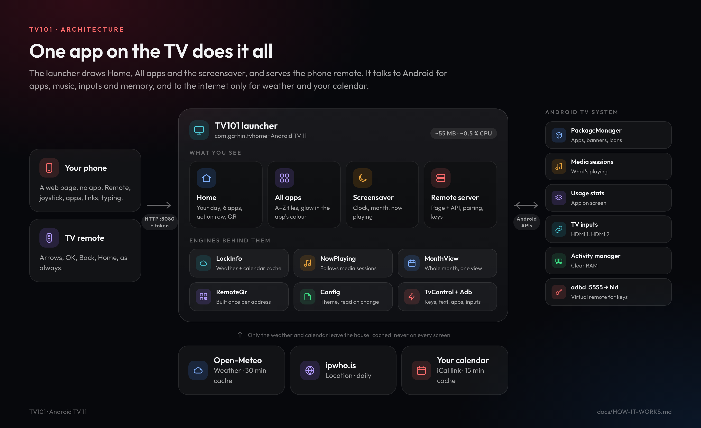
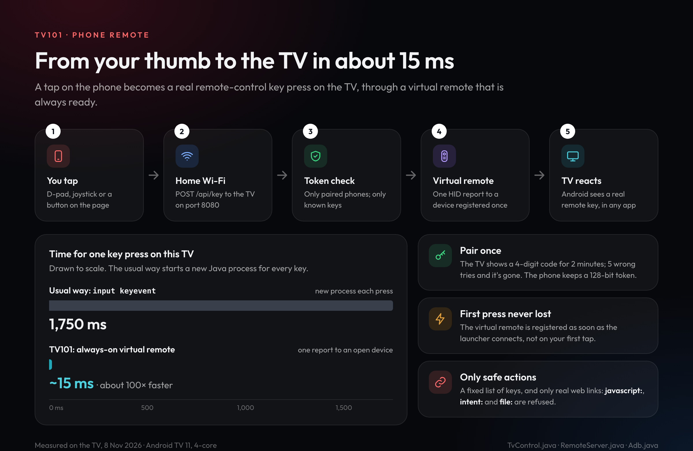
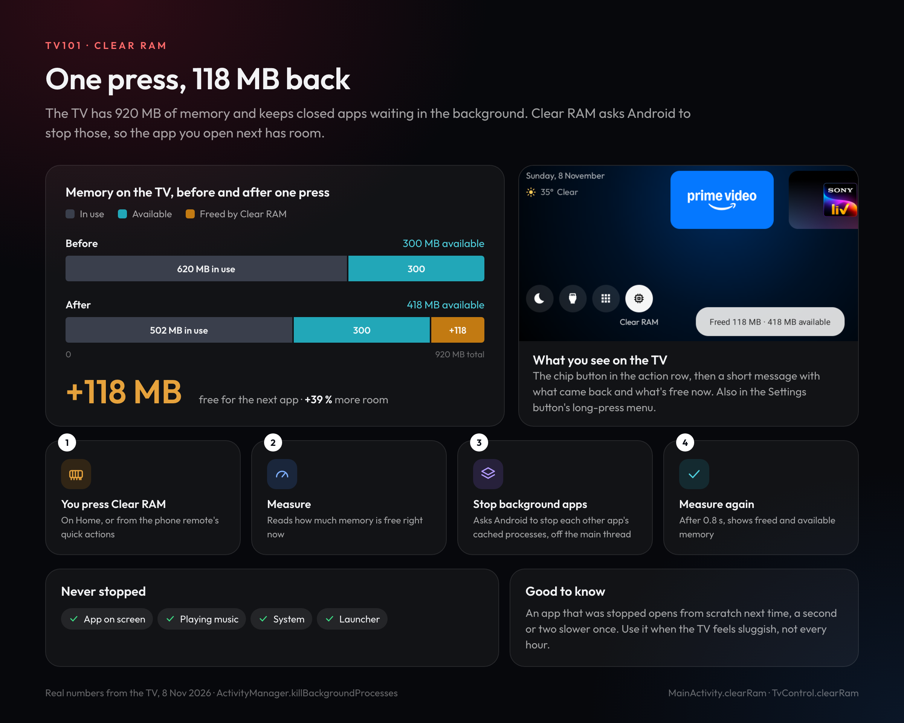
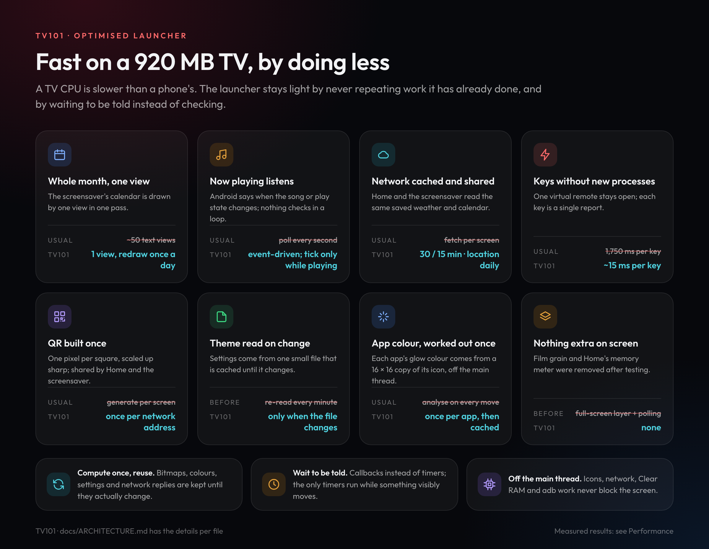
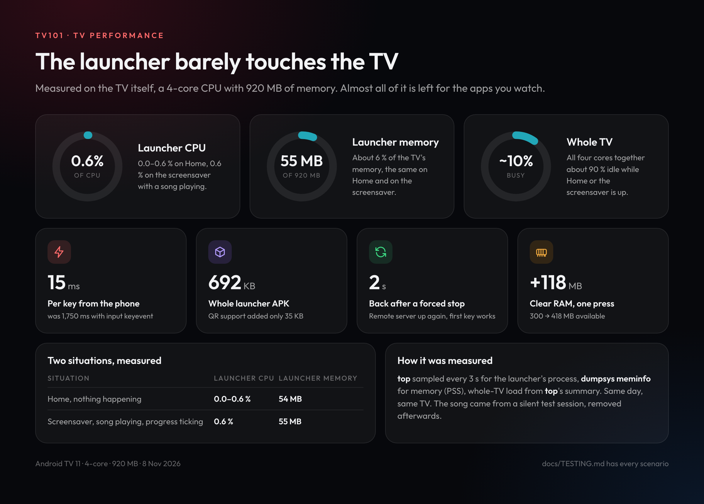
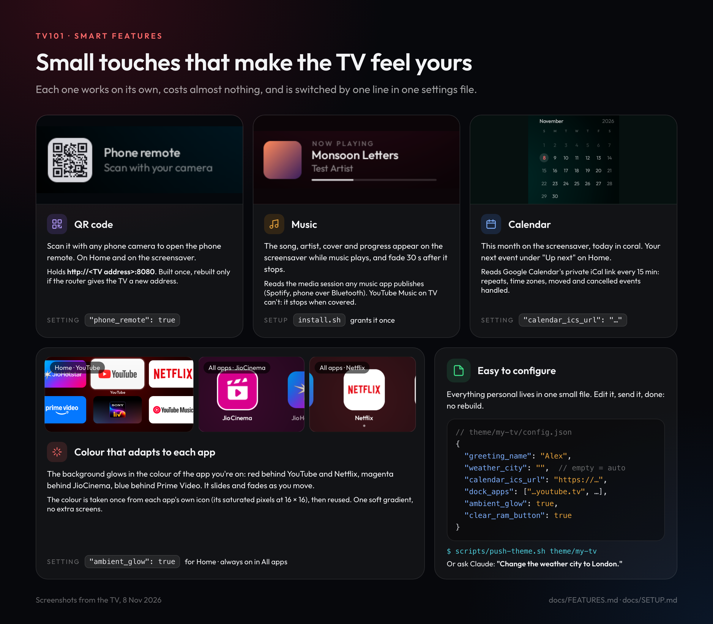

# How TV101 works

Six pictures, each answering one question. The numbers in them were measured on the TV itself
(an Android TV 11 set with a 4-core CPU and 920 MB of memory) on 8 November 2026.

---

## 1. What is it made of?



**One app on the TV does everything.** The launcher draws Home, All apps and the screensaver, and also runs a small
web server for the phone remote.

- **Left:** your two ways in, the phone and the normal TV remote.
- **Middle:** the four things you see, and the six small engines behind them.
- **Right:** the Android services it uses, for apps, music, the app on screen, HDMI and memory.
- **Bottom:** the only things that go out to the internet, the weather and your calendar. Both are saved
  and reused, never fetched for every screen.

---

## 2. How does the phone control the TV so fast?



The usual way to press a key on Android TV from software, `input keyevent`, starts a new program every time. On this
TV that takes **1.75 seconds per key**, far too slow for a remote.

TV101 instead creates a **virtual remote control** once and keeps it open, so each tap becomes a single message to
it. That takes **about 15 ms**, roughly 100 times faster, and to the TV it is a real remote.

Only phones that have paired with the code shown on the TV can use it. Only a fixed set of keys and real web links
are accepted.

---

## 3. What does Clear RAM actually do?



The TV keeps apps you've closed waiting in memory. **Clear RAM** asks Android to stop those background apps, then
measures again and tells you what came back.

In the measured press, available memory went from **300 MB to 418 MB (+118 MB, +39 %)**. The app on screen, music
that is playing, system services and the launcher itself are never stopped.

---

## 4. Why is it so light?



Three habits run through the whole launcher:

- **Compute once, reuse.** The QR code, each app's colour, your settings and the weather are kept until they
  actually change.
- **Wait to be told.** Music, settings and the clock react to Android's callbacks instead of checking in a loop.
- **Off the main thread.** Icons, network, Clear RAM and remote work never freeze the screen.

Each card shows the usual approach next to what TV101 does instead.

---

## 5. How much of the TV does it use?



| | Launcher CPU | Launcher memory |
|---|---|---|
| Home, nothing happening | 0.0–0.6 % | 54 MB |
| Screensaver, song playing | 0.6 % | 55 MB |

The whole TV stays about **90 % idle**. The launcher APK is **692 KB**. After being force-stopped, the remote server
is back within **2 seconds**.

---

## 6. What do the smart features do, and how do I set them?



| Feature | What you get | How to set it |
|---|---|---|
| **QR code** | Scan to open the phone remote, from Home or the screensaver. It updates itself if the TV's address changes. | On by default (`"phone_remote": true`) |
| **Music** | Song, artist, cover and progress on the screensaver while music plays. | Granted once by `scripts/install.sh` |
| **Calendar** | This month on the screensaver, and your next event on Home. | `"calendar_ics_url"`: your Google Calendar *secret address in iCal format* |
| **Colour that adapts** | The background glows in the colour of the app you're on. | `"ambient_glow": true` (Home); always on in All apps |
| **Weather** | Temperature and sky on Home and the screensaver. | `"weather_city"`, or leave it empty for automatic |

All of these live in **one file**: start from [`theme/default/config.json`](../theme/default/config.json), copy the folder
to `theme/my-tv` (kept off GitHub), edit it, then send it to the TV:

```sh
TV_HOST=192.168.1.50 scripts/push-theme.sh theme/my-tv
```

Or ask Claude Code in plain English: *"Change the weather city to London"*. See the [guide](GUIDE.md#3-let-claude-do-it).

---

### Editing these pictures

Each picture is a small HTML page in [`docs/visuals/src/`](visuals/src/) (shared look in `style.css`, icons in
`icons.js`). Change the text or numbers there, then render the PNGs again at 2× with headless Chrome:

```sh
docs/visuals/render.sh                 # all of them
docs/visuals/render.sh 03-clear-ram    # just one
```
