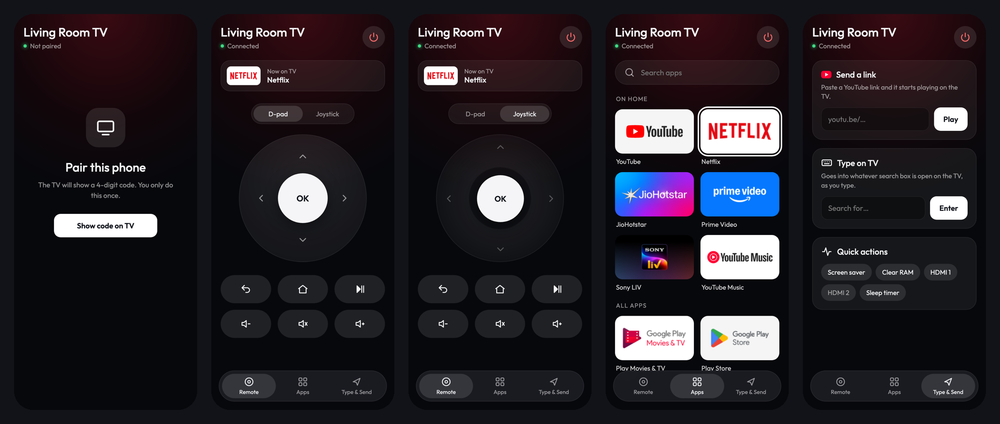

# Phone remote

A web page the launcher serves on port 8080, so any phone on the home Wi-Fi is a remote. No app to install.



The page is `launcher/app/src/main/assets/remote/index.html` (one file, no libraries). The server is
`RemoteServer.java`, kept running by the foreground service `RemoteService.java`; what it does to the TV is
`TvControl.java`.

## How it controls the TV

| What | How | Speed |
|---|---|---|
| Arrow keys, OK, Back, Home, play/pause, volume, sleep | A virtual remote control: the shell's `hid` tool registers a HID consumer-control device once and stays running; each press is one report | ~15 ms |
| Typing, Delete, Enter | `input text` / `input keyevent` through the shell | ~2 s |
| Open an app, a link, an HDMI input, the screensaver | The launcher starts it itself (allowed from the background by the `SYSTEM_ALERT_WINDOW` grant) | instant |
| What is on screen | Usage events (`GET_USAGE_STATS` grant) | instant |
| Clear RAM, sleep timer | In the launcher | instant |

The shell comes from the TV's own ADB on `127.0.0.1:5555`: `Adb.java` is a small ADB client that signs in with
the launcher's own RSA key. The TV asks to allow that key once ("Always allow").

## Pairing and security

- Every API call except `/api/hello` and pairing needs a token (`X-Token` header, or `?t=` for images).
- A token comes only from a 4-digit code the TV shows on screen for 2 minutes. Five wrong tries discard the code.
- Up to ten paired phones are remembered (the oldest is dropped).
- Links: only `http(s)` addresses with a real host open; `javascript:`, `intent:`, `file:` and the like are refused.
- Keys: only the fixed list in `TvControl` (no arbitrary key codes, no shell commands from the page).
- The server only listens on the home network; there is no HTTPS, so treat the Wi-Fi as the trust boundary.

## API

| Method | Path | Body | Answer |
|---|---|---|---|
| GET | `/api/hello` | | `{name, paired}` |
| POST | `/api/pair` | | shows a code on the TV |
| POST | `/api/pair/confirm` | `{code}` | `{token}` or 403 |
| GET | `/api/state` | | `{control: ok\|allow\|off, sleepAt, now: {pkg, label, home}}` |
| GET | `/api/apps` | | `{home: [...], all: [...], inputs: [{id, label, connected}]}` |
| GET | `/art/<package>?t=` | | the app's TV banner as PNG |
| POST | `/api/key` | `{key: up\|down\|left\|right\|ok\|back\|home\|playpause\|volup\|voldown\|mute\|sleep}` | `{ok}` |
| POST | `/api/text` | `{text, delete, enter}` | `{ok}` |
| POST | `/api/launch` | `{pkg}` | `{ok}` |
| POST | `/api/link` | `{url}` | `{ok}` |
| POST | `/api/input` | `{id}` | `{ok}` |
| POST | `/api/action` | `{name: screensaver\|clearram\|power\|sleep, minutes}` | `{ok}` or `{freed}` |

`control` is `allow` while the TV is showing the "Allow USB debugging?" prompt for the launcher's key, and `off` when
network ADB is closed; apps, links and inputs still work then, keys and typing do not.

## Designing the page without a TV

```sh
python3 phone-remote/dev-server.py            # then open http://localhost:8099 in a 390 × 844 window
python3 phone-remote/dev-server.py --art DIR  # with app banners saved as DIR/<package>.png
```

It serves the real page and answers the API with sample data; key presses and links are printed.
`/__shot?tab=remote|apps|send&mode=pad|stick&paired=1|0` frames the page at phone size for screenshots, which is how
the images in `docs/screenshots/phone/` were made (headless Chrome, 2× scale).
